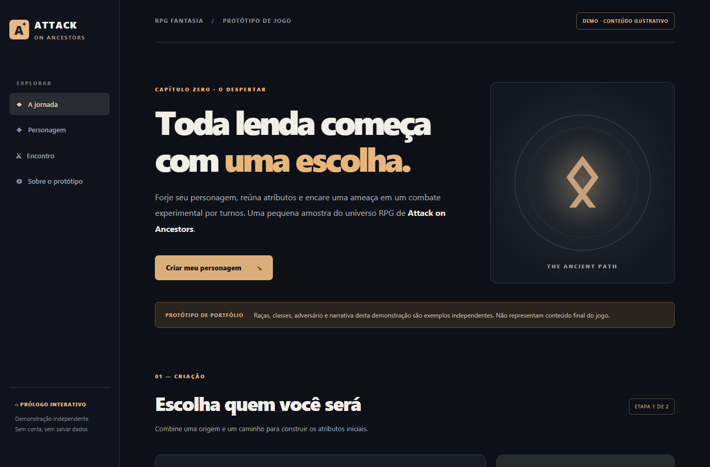
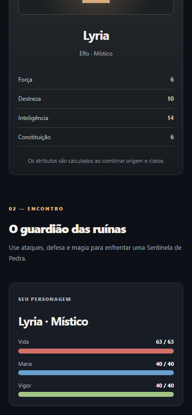

# Attack on Ancestors

**Protótipo de RPG de fantasia**, com criação de personagens, atributos e mecânicas de combate. O projeto explora sistemas de jogo em Python e inclui uma experiência interativa de batalha por turnos que pode ser executada no navegador.

## Experimente o protótipo

| Tela inicial | Versão mobile |
| --- | --- |
|  |  |

### Funcionalidades da demonstração

- **Criação de personagem:** escolha um nome, raça e classe.
- **Atributos:** força, destreza, inteligência e constituição definidos pela combinação escolhida.
- **Combate por turnos:** enfrente uma Sentinela de Pedra usando ataque, defesa e magia.
- **Recursos de combate:** acompanhe vida, mana e vigor.
- **Diário da batalha:** visualize o resultado de cada ação e reinicie o encontro quando quiser.
- **Interface responsiva:** experiência disponível em desktop e celular.

A demonstração é uma **amostra independente do sistema de combate**, com classes, inimigos e narrativas ilustrativos. Não representa um jogo completo nem o conteúdo final do universo.

## Como executar a demonstração

**Requisito:** Python 3, utilizado somente para iniciar um servidor local.

```bash
git clone https://github.com/JackNoArms/Attack_on_Ancestors.git
cd Attack_on_Ancestors
python -m http.server 8000
```

Abra **http://localhost:8000/demo/**.

Não é necessário instalar bibliotecas adicionais, criar conta ou fornecer dados pessoais para experimentar o encontro.

## O projeto em Python

O repositório também contém o protótipo original, com módulos para representar personagens, raças, classes, itens, localidades, inventário e um bestiário. Há interfaces experimentais desenvolvidas com Dash e outros componentes gráficos.

A evolução pode ser explorada nas seguintes áreas:

```text
classes/        Modelos Python e lógica de RPG
game_data/      Estruturas CSV utilizadas pelo protótipo
demo/           Criação de personagens e batalha no navegador
assets/         Recursos visuais e sonoros
tests/          Testes de regras de jogo e cadastro local
```

O protótipo Python utiliza bibliotecas históricas relacionadas a Dash e Kivy, listadas em `requirements.txt`. Alguns módulos ainda dependem de ambiente e recursos específicos; **a demonstração em `demo/` é a forma recomendada de explorar o projeto**.

## Tecnologias

**Python**, **Dash**, **Kivy**, **HTML**, **CSS**, **JavaScript** e **Node.js Test Runner** (para testar as regras da demonstração).

## Testes

Com Python 3 e Node.js 20 ou superior:

```bash
python -m unittest discover -s tests -p test_auth_store.py
node --test tests/game.test.mjs
```

O cadastro experimental em Python utiliza armazenamento local, separado da demonstração. Ele não fornece autenticação web pronta para produção; consulte [Segurança](docs/SECURITY.md) para seus limites.

*Attack on Ancestors é um projeto independente de RPG em desenvolvimento.*
